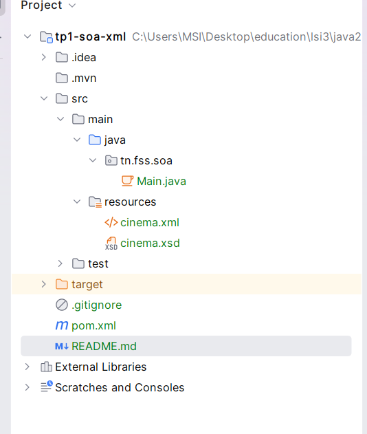
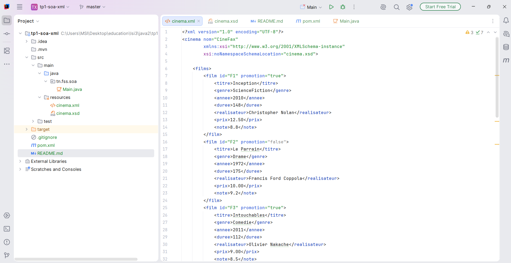
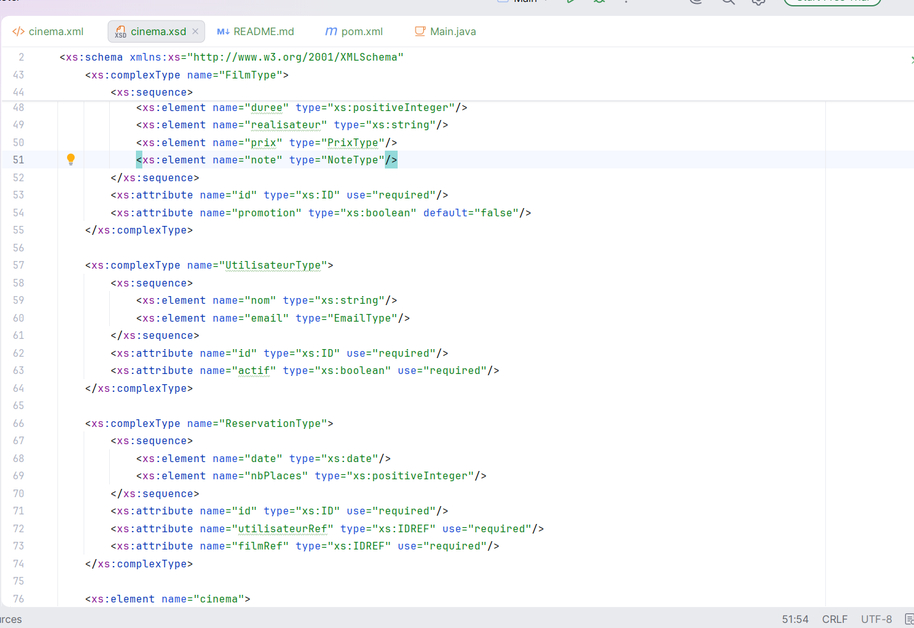
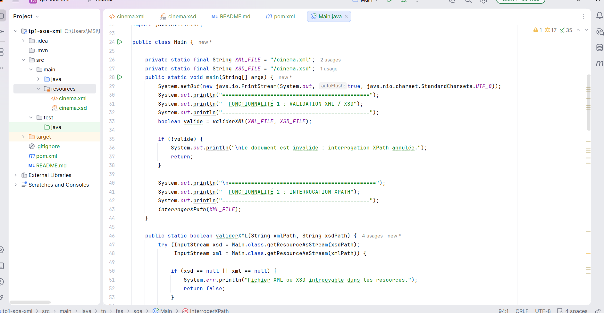
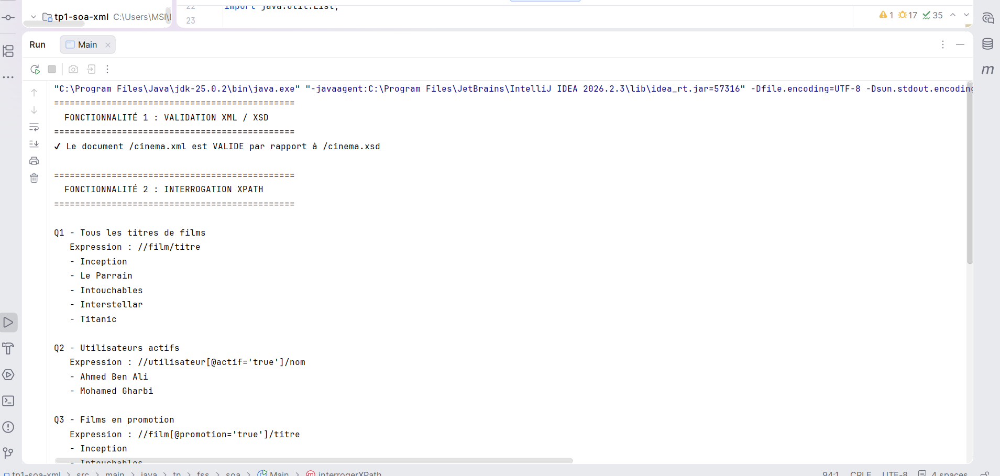

# TP1 – Modélisation XML et interrogation XPath avec Maven en Java

> **Matière :** Architecture SOA et services Web – **Filière :** LSI3
> **Domaine :** gestion d'un cinéma appelé *CineFax*

## Table des matières

1. [Présentation du projet](#1-présentation-du-projet)
2. [Objectifs pédagogiques](#2-objectifs-pédagogiques)
3. [Technologies utilisées](#3-technologies-utilisées)
4. [Structure du projet](#4-structure-du-projet)
5. [Modélisation XML](#5-modélisation-xml)
6. [Schéma XSD](#6-schéma-xsd)
7. [Application Java](#7-application-java)
8. [Installation et exécution](#8-installation-et-exécution)
9. [Résultats](#9-résultats)
10. [Dépôt GitHub](#10-dépôt-github)
11. [Conclusion](#11-conclusion)

---

## 1. Présentation du projet

Ce projet est réalisé dans le cadre du TP1 de la matière *Architecture SOA et services Web*, filière LSI3.

L'objectif est de modéliser un domaine réel à l'aide de XML, de créer un schéma XSD pour valider les données et de développer une application Java permettant de valider un document XML et de l'interroger à l'aide de XPath.

## 2. Objectifs pédagogiques

- Modéliser un domaine réel avec XML.
- Définir un schéma XSD pour contrôler la structure et les types de données.
- Créer un projet Java avec Maven.
- Implémenter la validation XML/XSD avec `SchemaFactory` et `Validator`.
- Interroger un document XML avec `XPathFactory` et `XPathExpression`.
- Exécuter le programme et vérifier les résultats obtenus.

## 3. Technologies utilisées

| Technologie | Rôle |
|---|---|
| Java JDK 11 | Langage et environnement d'exécution |
| Maven | Gestion du projet et des dépendances |
| IntelliJ IDEA Community Edition | Environnement de développement |
| XML et XML Schema (XSD) | Modélisation et validation des données |
| JAXP et XPath | Validation et interrogation du document |
| JUnit 5 | Tests éventuels |

## 4. Structure du projet

```text
tp1-soa-xml/
├── pom.xml
├── README.md
├── .gitignore
├── images/
│   ├── 01_structure_projet.png
│   ├── 02_cinema_xml.png
│   ├── 03_cinema_xsd.png
│   ├── 04_main_java.png
│   ├── 05_resultats_execution.png
│   └── 06_repository_github.png
└── src/
    ├── main/
    │   ├── java/
    │   │   └── tn/fss/soa/
    │   │       └── Main.java
    │   └── resources/
    │       ├── cinema.xml
    │       └── cinema.xsd
    └── test/
        └── java/
```



## 5. Modélisation XML

Le fichier `cinema.xml` représente les données du cinéma CineFax. Il contient trois ensembles principaux.

| Élément | Contenu |
|---|---|
| **Films** | identifiant, titre, genre, année de sortie, durée, réalisateur, prix du billet, note, attribut `promotion` |
| **Utilisateurs** | identifiant, nom, adresse e-mail, attribut `actif` |
| **Réservations** | identifiant, référence vers un utilisateur, référence vers un film, date, nombre de places |

Les attributs `id`, `utilisateurRef` et `filmRef` permettent d'identifier les éléments et de relier les réservations aux utilisateurs et aux films correspondants.



## 6. Schéma XSD

Le fichier `cinema.xsd` définit les règles de validation du document XML.

### Types simples personnalisés

| Type | Contrainte |
|---|---|
| `GenreType` | limite les genres aux valeurs autorisées |
| `AnneeType` | année comprise entre 1888 et 2100 |
| `NoteType` | note comprise entre 0 et 10 |
| `PrixType` | prix strictement positif, au maximum deux chiffres après la virgule |
| `EmailType` | vérifie le format des adresses e-mail |

### Types complexes

`FilmType`, `UtilisateurType` et `ReservationType` définissent la structure des éléments correspondants.

Les attributs `xs:ID` et `xs:IDREF` servent à identifier les éléments et à vérifier les références entre les réservations, les films et les utilisateurs.



## 7. Application Java

La classe principale `Main.java` regroupe les deux fonctionnalités du TP.



### 7.1. Fonctionnalité 1 : validation XML/XSD

La méthode `validerXML()` utilise :

- `SchemaFactory` pour créer le schéma à partir du fichier XSD ;
- `Schema` pour représenter le schéma ;
- `Validator` pour vérifier la conformité du document XML.

Si le document est valide, un message de confirmation est affiché. En cas d'erreur, le programme affiche les informations disponibles pour faciliter la correction.

### 7.2. Fonctionnalité 2 : interrogation XPath

La méthode `interrogerXPath()` charge le document XML et exécute dix requêtes XPath à l'aide de `XPathFactory` et `XPathExpression`. La méthode `afficherListe()` affiche les résultats des requêtes qui renvoient une liste de nœuds.

#### Liste des requêtes

| N° | Description | Expression XPath |
|---|---|---|
| Q1 | Tous les titres de films | `//film/titre` |
| Q2 | Utilisateurs actifs | `//utilisateur[@actif='true']/nom` |
| Q3 | Films en promotion | `//film[@promotion='true']/titre` |
| Q4 | Films sortis après 2010 | `//film[annee > 2010]/titre` |
| Q5 | Films dont la note est ≥ 8,6 | `//film[note >= 8.6]/titre` |
| Q6 | Films réalisés par Christopher Nolan | `//film[realisateur='Christopher Nolan']/titre` |
| Q7 | Films réservés par l'utilisateur U1 | `//film[@id=//reservation[@utilisateurRef='U1']/@filmRef]/titre` |
| Q8 | Nombre total de films | `count(//film)` |
| Q9 | Prix moyen des billets | `sum(//film/prix) div count(//film)` |
| Q10 | Nom du premier utilisateur | `/cinema/utilisateurs/utilisateur[1]/nom` |

#### Explication de quelques requêtes

**Q1 – Tous les titres de films**

```xpath
//film/titre
```

Sélectionne les titres de tous les films du document.

**Q2 – Utilisateurs actifs**

```xpath
//utilisateur[@actif='true']/nom
```

Sélectionne les noms des utilisateurs dont l'attribut `actif` vaut `true`.

**Q3 – Films en promotion**

```xpath
//film[@promotion='true']/titre
```

Récupère les titres des films dont l'attribut `promotion` vaut `true`.

**Q7 – Films réservés par l'utilisateur U1**

```xpath
//film[@id=//reservation[@utilisateurRef='U1']/@filmRef]/titre
```

Recherche les réservations de l'utilisateur U1, récupère les références des films concernés, puis sélectionne leurs titres.

**Q8 – Nombre total de films**

```xpath
count(//film)
```

Compte le nombre total d'éléments `film`.

**Q9 – Prix moyen des billets**

```xpath
sum(//film/prix) div count(//film)
```

Calcule la somme des prix et la divise par le nombre de films.

## 8. Installation et exécution

### Prérequis

- JDK 11 ou une version compatible avec la configuration Maven
- IntelliJ IDEA Community Edition
- Maven

### Depuis IntelliJ IDEA

1. Ouvrir le projet dans IntelliJ IDEA.
2. Vérifier que Maven a correctement chargé les dépendances du fichier `pom.xml`.
3. Vérifier que `cinema.xml` et `cinema.xsd` se trouvent dans `src/main/resources/`.
4. Ouvrir `Main.java`.
5. Cliquer sur le bouton **Run** à côté de la méthode `main()`.

### Depuis un terminal

À la racine du projet :

```bash
mvn clean compile
mvn exec:java
```

La première fonctionnalité valide le document XML. Si la validation réussit, la deuxième fonctionnalité exécute les requêtes XPath.

## 9. Résultats

### Résultats attendus

| Requête | Résultat |
|---|---|
| Q1 | Inception, Le Parrain, Intouchables, Interstellar, Titanic |
| Q2 | Ahmed Ben Ali, Mohamed Gharbi |
| Q3 | Inception, Intouchables |
| Q4 | Intouchables, Interstellar |
| Q5 | Inception, Le Parrain, Interstellar |
| Q6 | Inception, Interstellar |
| Q7 | Inception, Interstellar |
| Q8 | 5 films |
| Q9 | 10,60 DT |
| Q10 | Ahmed Ben Ali |

La validation XML/XSD doit réussir si le document XML respecte toutes les contraintes du schéma.

### Capture de l'exécution




## 10. Conclusion

Ce TP m'a permis de mettre en pratique la modélisation d'un domaine réel en XML, la définition d'un schéma XSD et la validation d'un document XML avec Java.

J'ai également utilisé XPath pour extraire des informations sur les films, les utilisateurs et les réservations. Le projet Maven regroupe les fichiers nécessaires à l'exécution et permet de vérifier les deux fonctionnalités demandées.
